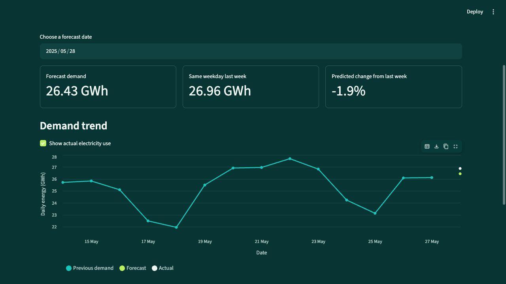
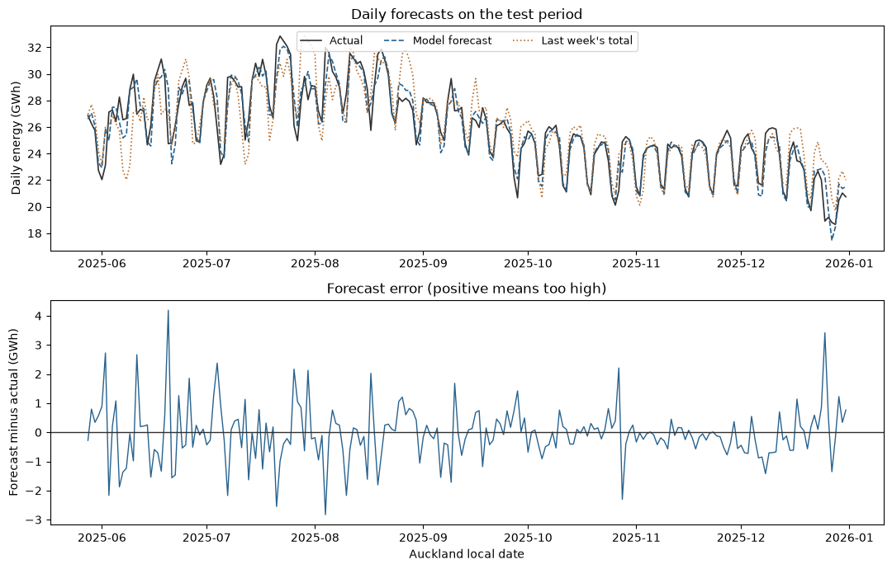

# Auckland electricity forecasting

A Python forecasting project with a Streamlit app for exploring electricity demand predictions and simulating purchasing costs.

The project asks whether daily electricity demand can be predicted more accurately than simply using demand from the same weekday a week earlier. It covers regional Auckland demand and includes model comparison, a working app and scripts for reproducing the results.

**Main result:** the notebook's selected linear regression reduced historical test RMSE by **41.2%**, from **1.614 to 0.949 GWh**. The app displays a second linear-regression model with additional weather and calendar inputs, with RMSE of **0.789 GWh** on the same test dates.

This is a historical demonstration. Choosing a date displays a saved forecast. The app does not generate live predictions, and its purchasing results are simulated comparisons.

## Try the app

Use **Python 3.14**. No API key, cloud account or additional data download is needed. All app inputs are included.

Clone the repository, or download its ZIP and open a terminal in the extracted project folder:

```bash
git clone https://github.com/OscarIronside/auckland-electricity-forecasting.git
cd auckland-electricity-forecasting
```

On macOS or Linux, create and activate an environment:

```bash
python3.14 -m venv .venv
source .venv/bin/activate
```

On Windows PowerShell:

```powershell
py -3.14 -m venv .venv
.venv\Scripts\Activate.ps1
```

Then install the app dependencies and launch it:

```bash
python -m pip install -r requirements-demo.txt
python -m streamlit run app.py
```

Open the local URL printed by Streamlit. To stop the app, press Ctrl+C in the terminal. See [setup and troubleshooting](docs/SETUP.md) if Python, environment activation or a full notebook installation needs attention.



The app has two views:

- **Demand forecast:** select any of the 218 test dates, view recent demand, compare the prediction with the previous-week benchmark and reveal actual demand.
- **Purchasing simulation:** adjust the advance purchase price and surplus resale rate. Both forecasts use identical purchasing rules. Shortfalls are bought at a daily market-price proxy, while surplus is resold at the selected rate.

Before displaying results, the app checks dates, numeric values, actual demand, benchmarks and complete price coverage. Incomplete or inconsistent inputs produce a clear error instead of partial cost totals.

## Understand the results

The notebook compares linear regression, random forest and XGBoost. It uses past demand and calendar features, selects the model using validation data, then refits it before the final test.

| Period | Dates | Days after lag creation |
| --- | --- | ---: |
| Training | 8 January 2023 to 31 December 2024 | 724 |
| Validation | 1 January to 27 May 2025 | 147 |
| Test | 28 May to 31 December 2025 | 218 |

| Forecast | MAE in GWh | RMSE in GWh |
| --- | ---: | ---: |
| Previous-week benchmark | 1.198 | 1.614 |
| Notebook model | 0.658 | 0.949 |
| App forecasting model | 0.573 | 0.789 |

MAE measures average absolute forecast error. RMSE gives greater weight to large errors. Lower values mean predictions were closer to observed demand.

The **41.2% reduction belongs to the notebook model**. The app uses a separate linear regression with additional preceding-day weather, demand-history and holiday features. Its forecasts are retained in `historical_forecasts.csv` and can be recreated with the included code. Neither result establishes future production performance.



## Reproduce the results

The following commands assume the environment above is active and the terminal is in the project folder.

To refit the notebook's selected model using the daily input and check its metrics:

```bash
python -m pip install -r requirements-evaluation.txt
python scripts/reproduce_results.py
```

Expected test RMSE is `0.948777 GWh` against a benchmark of `1.613599 GWh`, a `41.2%` reduction. The script also validates the app inputs and scores its separate forecasts.

To recreate the app's selected model from the included demand and weather inputs:

```bash
python scripts/reproduce_app_forecasts.py
```

This checks all 218 forecasts against the committed CSV. Expected RMSE is `0.789128 GWh`. It recreates that fit, rather than rerunning every experiment from the wider group assignment.

To rerun the full notebook, including model comparison, tuning and SHAP explanations, follow the [system prerequisites](docs/SETUP.md#full-notebook-prerequisites), then run:

```bash
python -m pip install -r requirements.txt
python scripts/run_notebook.py
```

The runner executes all 35 code cells and writes `reports/forecasting-executed.ipynb`. It leaves the committed notebook unchanged. You can also open `forecasting.ipynb` in a notebook editor, select this environment and run it from the project folder.

To run the regression checks after installing the app and evaluation dependencies:

```bash
python -m unittest discover -s tests -v
```

See [verification](docs/VERIFICATION.md) for the environment actually tested and the boundary between local checks and automated checks on GitHub.

## Data and limitations

The demand series contains 1,096 complete days from 2023 to 2025. It aggregates Electricity Authority EMI reconciled offtake for Vector's Waitemata and Auckland reporting regions, IDs 3 and 4. This is regional electricity use, rather than an individual customer's usage or an exact administrative boundary. Daily aggregation accounts for daylight-saving transitions.

Included inputs and source attributions are described in [Data](docs/DATA.md). The app's Otahuhu price series is an unweighted daily average used as a regional proxy.

Each test forecast uses observations preceding that date. The data is retrospective and includes later revisions, so the evaluation does not establish what information would have been available at a real purchasing deadline. It is not a single 218-day forecast made at the start of the test period.

The purchasing simulation assumes fixed advance purchase prices and a chosen surplus resale rate. It omits network charges, transaction costs and customer-specific tariffs. A lower forecast error does not guarantee a lower cost under every set of assumptions. See [Evaluation](docs/EVALUATION.md) for the complete protocol and limitations.

## Project contribution

The project originated in group coursework at Massey University. Oscar Ironside contributed across the model experiments and Streamlit app, and used Codex for planning and debugging. The notebook comparison and app model are separate pieces of the group's work.

The documentation, reproduction scripts, validation checks and automated handoff checks were added during portfolio preparation with Codex assistance. They should be distinguished from the original coursework deliverable.

## Where to look

| File | Purpose |
| --- | --- |
| `app.py` | Forecast viewer and purchasing simulation |
| `data_validation.py` | Input checks shared by the app and result reproduction |
| `forecasting.ipynb` | Explained model comparison, tuning, SHAP and test evaluation |
| `daily_demand.csv` | 1,096 daily demand observations in GWh |
| `historical_forecasts.csv` | 218 daily forecasts, actual demand and previous-week benchmarks |
| `otahuhu_daily_prices.csv` | Daily price proxy and interval counts |
| `scripts/reproduce_results.py` | Refit and score the selected notebook model |
| `scripts/reproduce_app_forecasts.py` | Recreate the app's forecasting model |
| `scripts/app_forecasting.py` | App-model data preparation and feature code |
| `data/` | Included half-hourly demand and hourly weather inputs |
| `tests/` | Data-validation and app regression checks |
| `docs/` | Setup, provenance, evaluation and verification |
